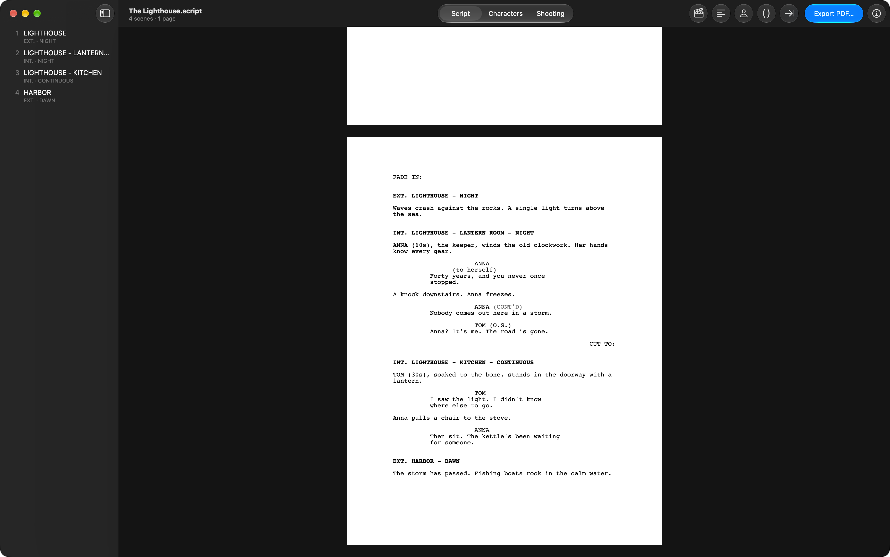

<p align="center">
  
</p>

<h1 align="center">Screenplay Writer</h1>

<p align="center">
  A macOS app for writing film and TV screenplays on page-accurate sheets, with a character manager and a shooting plan.<br>
  Built with SwiftUI and TextKit; scripts are plain <a href="https://fountain.io">Fountain</a> text.
</p>

<p align="center">
  
</p>

## Features

- **Write on the page**: the editor shows the script on white sheets of the chosen paper, even in Dark Mode, with the same page breaks, (MORE) and (CONT'D) as the exported PDF.
- **Screenplay elements**: Scene Heading, Action, Character, Parenthetical and Transition from the toolbar buttons or the Screenplay menu (⌘1–⌘5). Pressing ⌘1 again on a heading cycles INT. → EXT. → INT./EXT.
- **Formatting as you type**: scene headings, character cues and transitions are capitalized automatically, a character speaking again after action gets (CONT'D), and Fountain's marks (`!`, `@`, `.`, `>`, `<`) are hidden on the sheet.
- **Bold, italic, underline**: ⌘B, ⌘I and ⌘U, saved as Fountain emphasis; the marks show only on the line being written.
- **Export PDF…** (⇧⌘E): standard screenplay format in Courier 12 with a title page and page numbers, on A4, A3, US Letter or US Legal. Scene numbers and bold scene headings are options in Settings.
- **Scene list**: the sidebar lists every scene; clicking one jumps to it on its sheet.
- **Characters** (⌃⌘2): every speaking character with their lines, scenes and first scene. Rename Character… renames a character in its cues and, if you like, throughout action and dialogue. A side panel keeps the actor, phone, email and notes for each character.
- **Shooting plan** (⌃⌘3): scenes grouped by location, or by location and time of day, with each scene's length in eighths of a page and the total per location. CONTINUOUS and LATER scenes take the time of the scene before.
- **Project Settings**: title, credit, author, source, draft date, contact, notes and paper size, edited in the inspector instead of in the text.
- **Margins**: the text column is centered on the page by default; Settings can set left, top and bottom margins or restore the standard 1.5" left, 1" top and bottom.
- **Italian conventions**: EST. for exteriors, transitions ending in " A:" (STACCO A:), and the time of day before the location (EST. NOTTE - PARCHEGGIO). The interface is in English and Italian and follows the system language.
- **Files**: new scripts are saved as `.script`, Fountain text with its own document icon. `.fountain` and plain text files open too and are saved as `.script`.

## Requirements

- macOS 14 Sonoma or later to run; macOS 26 or later shows the Liquid Glass design.
- Xcode 26 or later to build (Swift 6.2, and `actool` support for Icon Composer icons).

There are no other dependencies.

## Installation

```bash
git clone https://gitlab.com/giuliomaffei90/screenplay-writer.git
cd screenplay-writer
./build.sh --install
```

[build.sh](build.sh) builds the Swift package in release mode and assembles `build/Screenplay Writer.app`: it copies [Info.plist](Resources/Info.plist) and the translations, compiles [AppIcon.icon](AppIcon.icon) with `actool`, and signs the bundle ad hoc. It passes the real SDK version to the linker, because SwiftPM would otherwise record the deployment target as the SDK and macOS would draw the app with the old design. `--install` copies the app to `/Applications`.

For development, open the package in Xcode with `xed .`, or run the tests with `swift test`.

## How it works

1. A document is a [ScreenplayDocument](Sources/ScreenplayWriter/App.swift): the file's text, read and written as is. [Info.plist](Resources/Info.plist) exports the `.script` type and its document icon.
2. [ContentView](Sources/ScreenplayWriter/ContentView.swift) splits the Fountain title page from the script with `Fountain.splitTitlePage`. The title page holds the Project Settings, the paper size (`Paper:`) and the cast details (`Cast:`); the editor gets only the script.
3. `Fountain.parse` in [Fountain.swift](Sources/ScreenplayWriter/Fountain.swift) classifies each line (heading, action, character, dialogue…), and `Screenplay` collects the scenes, their locations and times, and the characters.
4. `Layout.blocks` and `Layout.paginate` in [Layout.swift](Sources/ScreenplayWriter/Layout.swift) wrap the lines at the standard widths and split them into pages: headings keep their first lines with them, action breaks between lines, dialogue breaks with (MORE) and (CONT'D). `Layout.pdf` draws those pages with Core Graphics.
5. [Editor.swift](Sources/ScreenplayWriter/Editor.swift) shows the same pages while you type: one TextKit 1 text container per sheet, all sharing a layout manager. Each container refuses lines past the point where the PDF starts a new page (`Layout.sheets`), the added (MORE) and (CONT'D) lines are drawn on the sheet, and Fountain marks are laid out with no glyph.
6. The shooting plan measures each scene with the same layout, in eighths of a page.

## Known limitations

- The editor's sheets follow the PDF's page breaks, but extra blank lines, notes and sections take room on screen and not in print; each sheet keeps four spare lines for this, and beyond that a sheet can end a line or two after the PDF page.
- Inside a long wrapped paragraph, the position of a page break is estimated, so the break can land one line off on screen.
- The layout is recomputed on each keystroke from the edited point onwards; very long scripts may feel slower.
- A block taller than a whole page that can't be split (for example a very long scene heading) runs past the bottom margin.
- Dual dialogue is printed as ordinary dialogue, and lyrics as action.
- Words longer than a line are broken without a hyphen.
- Undoing a rename restores the name in the text, not the cast details, which stay under the new name.
- Typing at the very start of a line that has a hidden mark can put the text before the mark and change the line's element.
- The multi-camera TV format (double-spaced dialogue, each scene on a new page) isn't supported.
